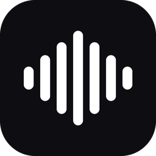

  

# xAI Grok for Home Assistant

An **unofficial** [Home Assistant](https://www.home-assistant.io/) integration for [xAI](https://x.ai)'s Grok, from [raine-works](https://github.com/raine-works), built for a fast voice assistant. It provides a conversation agent, speech to text and text to speech, and every stage streams. It also provides an AI Task entity for automations.

> This project is not affiliated with, authorized, or endorsed by xAI. It uses xAI's public API with your own API key, and xAI bills you for that usage.

## Features

| Stage | How it is fast |
| --- | --- |
| Speech to text | Audio is streamed to `wss://api.x.ai/v1/stt` while you are still speaking, so the transcript is ready almost as soon as you stop. |
| Conversation | Responses API over server-sent events. Text reaches Home Assistant token by token, and tools run as soon as the model asks for them. A stable `prompt_cache_key` keeps the system prompt and tool list in xAI's prompt cache. |
| Text to speech | Tokens are forwarded to `wss://api.x.ai/v1/tts` as they are generated and audio is played as it comes back. The WebSocket is opened when the conversation turn starts, so the handshake overlaps with the model's thinking time. |

It has no Python dependencies beyond Home Assistant itself. It also provides web and X search tools, an AI Task entity, and needs Home Assistant 2026.10 or newer.

## Quick install

1. Click the button above, or open Settings → Marketplace and add `https://github.com/raine-works/ha-grok` as a custom repository of type Integration.
2. Download **xAI Grok** and restart Home Assistant.
3. Add the integration under Settings → Devices & services and enter an API key from [console.x.ai](https://console.x.ai) (with Voice access).
4. In Settings → Voice assistants, pick *Grok*, *Grok Speech to text* and *Grok Text to speech*.

## Documentation

| Guide | What it covers |
| :--- | :--- |
| [Installation](docs/installation.md) | Marketplace or manual install |
| [Setup](docs/setup.md) | The API key, entities and options |
| [Conversation agent](docs/conversation.md) | Instructions, model, reasoning effort, search tools |
| [Speech to text](docs/speech-to-text.md) | Streaming transcription and languages |
| [Text to speech](docs/text-to-speech.md) | Voices, speed and latency |
| [A fast voice assistant](docs/voice-assistant.md) | A pipeline set up for speed |
| [AI Task](docs/ai-task.md) | Data and image generation |
| [Troubleshooting](docs/troubleshooting.md) | Known behavior and reporting issues |
| [Development](docs/development.md) | Tests and releases |

## Contributing

Issues and PRs welcome. This is a community project maintained on a best-effort basis. If something breaks, please include your Home Assistant version, the model you selected and any relevant Home Assistant logs.

## ☕ Support

If you find this project helpful, consider buying me a coffee to support continued
maintenance and development:

## License

[MIT](LICENSE) © [Raine Petersen](https://github.com/raine-works)
